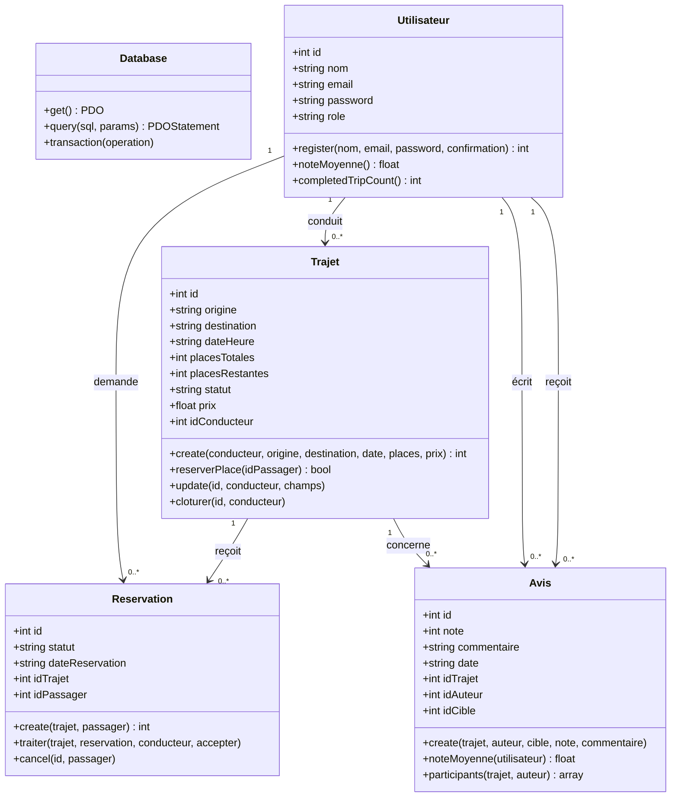
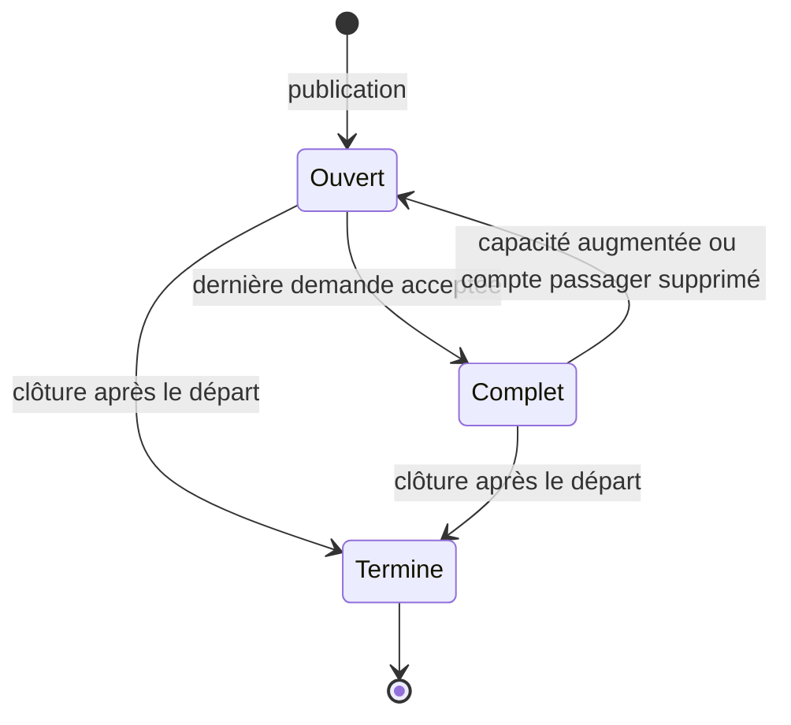

# Conception

## MLD

- **utilisateurs** : **id**, nom, email (unique), mot_de_passe, role, date_inscription.
- **trajets** : **id**, origine, destination, date_heure, places_totales, places_restantes, statut, prix, **id_conducteur → utilisateurs.id**.
- **reservations** : **id**, statut, date_reservation, **id_trajet → trajets.id**, **id_passager → utilisateurs.id**. Unicité `(id_trajet, id_passager)`.
- **avis** : **id**, note, commentaire, date_avis, **id_trajet → trajets.id**, **id_auteur → utilisateurs.id**, **id_cible → utilisateurs.id**. Unicité `(id_trajet, id_auteur, id_cible)`.

Toutes les clés étrangères utilisent une suppression en cascade. Les places sont restituées par la logique applicative avant la suppression d’un passager. Le rôle `membre` ne distingue pas conducteur et passager : ces rôles dépendent de chaque trajet. La propriété PHP `Utilisateur::password` correspond à la colonne SQL `mot_de_passe`.

## Diagramme de classes

La moyenne est nullable. `reserverPlace` est appelée pendant la confirmation, dans la transaction qui détient le verrou du trajet. Les propriétés complémentaires telles que les noms sont chargées par jointures pour les vues.

## Cycle de vie

La clôture nécessite l’identité du conducteur. Les trajets passés sont exclus de la recherche même si le conducteur ne les a pas encore clôturés. Un trajet terminé ne peut plus être modifié.

## Concurrence et sécurité

Chaque acceptation exécute `SELECT ... FOR UPDATE` sur le trajet, puis verrouille la demande. Deux acceptations du même trajet sont donc sérialisées dans MySQL : la seconde relit le compteur actualisé. Le changement du compteur et le changement de statut de la demande sont validés par un même `COMMIT`. En cas d’échec, `ROLLBACK` annule les deux opérations.

Les contraintes d’unicité de MySQL complètent les contrôles applicatifs. Les notes sont validées de 1 à 5, les commentaires jusqu’à 500 caractères, les places de 1 à 8 et le prix de 0 à 200 €. Les profils comptent les trajets terminés en tant que conducteur ou passager confirmé, sans double comptage. Le taux de remplissage est la moyenne des taux de chaque trajet, et non un ratio pondéré par sa capacité.

Les contrôleurs utilisent les conventions anglaises vues en cours et remplissent les responsabilités des `TrajetController`, `ReservationController` et `AvisController` cités dans le sujet.
