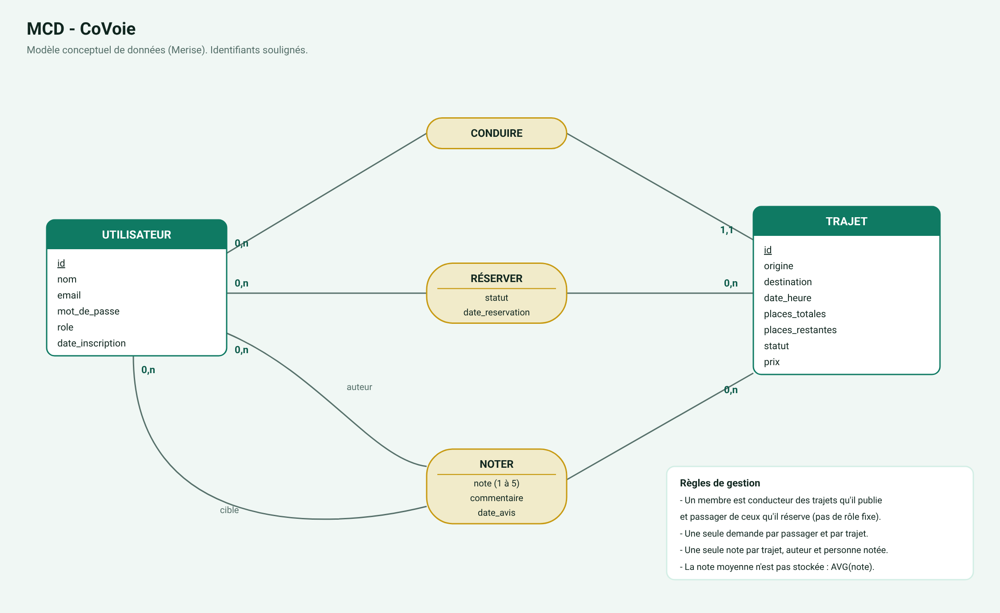
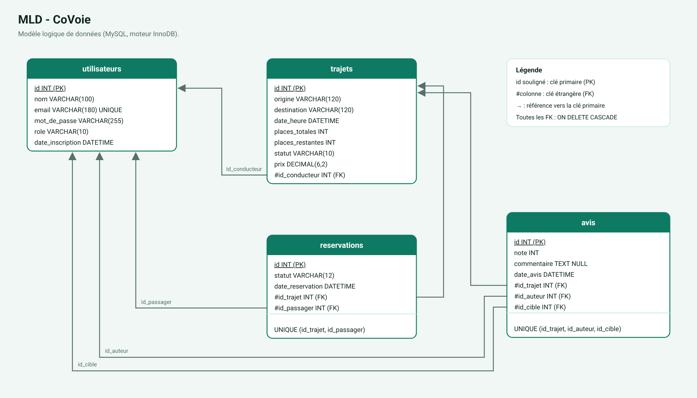
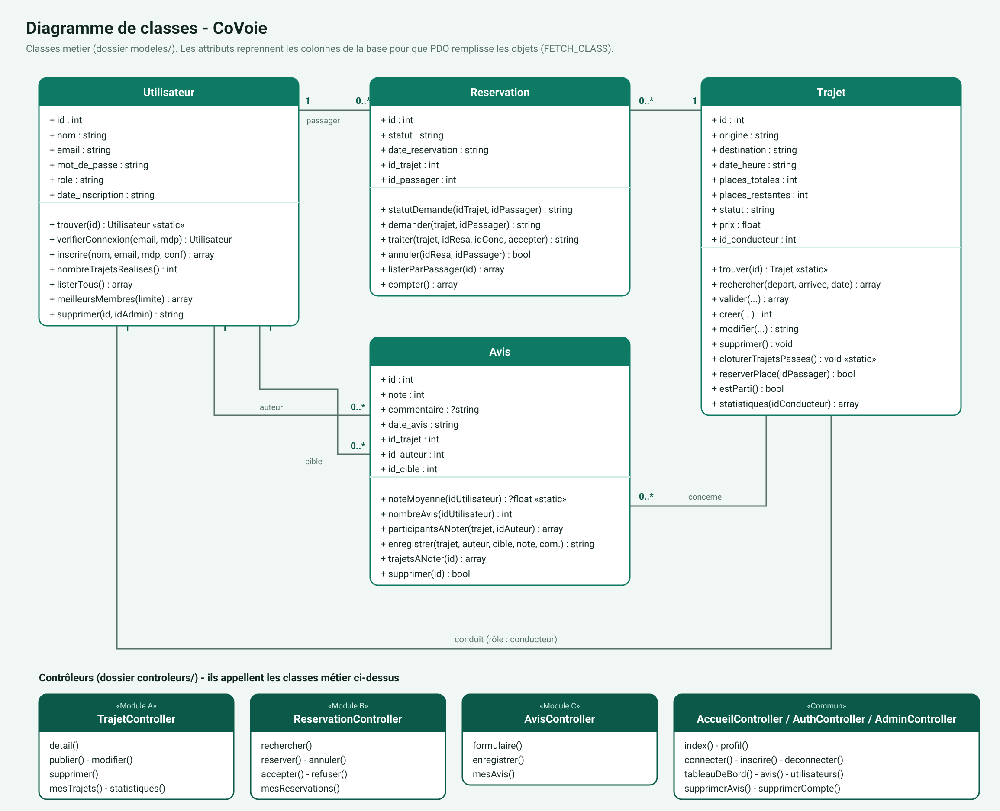

# Conception - CoVoie

## 1. MCD (Merise)



- **UTILISATEUR** (<u>id</u>, nom, email, mot_de_passe, role, date_inscription)
- **TRAJET** (<u>id</u>, origine, destination, date_heure, places_totales, places_restantes, statut, prix)
- **CONDUIRE** : UTILISATEUR (0,n) - TRAJET (1,1)
- **RÉSERVER** (statut, date_reservation) : UTILISATEUR (0,n) - TRAJET (0,n)
- **NOTER** (note, commentaire, date_avis) : association ternaire entre UTILISATEUR *auteur* (0,n),
  UTILISATEUR *cible* (0,n) et TRAJET (0,n)

Il n'y a pas d'entité CONDUCTEUR ni PASSAGER : un même compte est conducteur des trajets qu'il
publie et passager de ceux qu'il réserve.

## 2. MLD



- **utilisateurs** (<u>id</u>, nom, email, mot_de_passe, role, date_inscription)
- **trajets** (<u>id</u>, origine, destination, date_heure, places_totales, places_restantes, statut, prix, #id_conducteur)
- **reservations** (<u>id</u>, statut, date_reservation, #id_trajet, #id_passager) - UNIQUE (id_trajet, id_passager)
- **avis** (<u>id</u>, note, commentaire, date_avis, #id_trajet, #id_auteur, #id_cible) - UNIQUE (id_trajet, id_auteur, id_cible)

Les associations RÉSERVER et NOTER deviennent des tables. On leur donne un identifiant `id`
(plus simple à manipuler dans les URL) et la clé UNIQUE garde la règle « une seule fois ».
Toutes les clés étrangères sont en `ON DELETE CASCADE`.

Les statuts sont enregistrés **sans accent** (`Termine`, `Confirmee`, `Refusee`) : ce sont des
valeurs techniques comparées dans le code. La fonction `libelleStatut()` affiche le texte accentué.

## 3. Diagramme de classes



Les attributs des classes portent le même nom que les colonnes de la table : PDO peut ainsi
créer directement un objet rempli avec `fetchObject('Trajet')`.

Convention suivie dans les modèles :
- `trouver($id)` renvoie **un objet** (ou `null`) pour travailler sur un élément précis ;
- les méthodes `lister...()` renvoient **des tableaux** (avec des jointures, ex. le nom du conducteur) pour les listes affichées ;
- les méthodes qui modifient la base renvoient un **message d'erreur**, ou `''` si tout s'est bien passé.

Méthodes demandées par le cahier des charges :
- `Trajet::reserverPlace($idPassager)` - retire une place lors de l'acceptation d'une demande ;
- `Avis::noteMoyenne($idUtilisateur)` - méthode statique, renvoie la moyenne ou `null`.

## 4. Cycle de vie

**Trajet** : `Ouvert` → `Complet` (plus de place) → `Termine` (clôture automatique dès que l'heure de départ est passée).
Un trajet complet redevient `Ouvert` si le conducteur ajoute des places ou si l'admin supprime un passager.

**Réservation** : `En attente` → `Confirmee` (acceptée) ou `Refusee` (refusée par le conducteur, ou encore en attente au moment de la clôture).
Une demande en attente peut être annulée (supprimée) par le passager.

## 5. Acceptation d'une demande (transaction)

Accepter une demande modifie **deux tables** : il faut que les deux réussissent ensemble.

```php
$pdo->beginTransaction();
try {
    if (!$trajet->reserverPlace($idPassager)) {   // 1. trajets : places_restantes - 1
        $pdo->rollBack();
        return 'Il ne reste plus de place sur ce trajet.';
    }
    requete("UPDATE reservations SET statut = 'Confirmee' WHERE id = ?", [$id]);   // 2.
    $pdo->commit();
} catch (PDOException $erreur) {
    $pdo->rollBack();      // en cas d'erreur, rien n'est modifié
}
```

Dans `reserverPlace()`, la condition `places_restantes > 0` est écrite **dans** la requête `UPDATE` :
si deux acceptations arrivent en même temps, la seconde ne modifie aucune ligne (`rowCount() = 0`)
et le compteur ne peut jamais passer sous zéro.

## 6. Clôture automatique

Le sujet demande qu'un trajet « Ouvert » ou « Complet » passe « Terminé » quand il atteint sa date/heure.
`index.php` appelle `Trajet::cloturerTrajetsPasses()` au début de **chaque page** :

```sql
-- 1. les demandes encore en attente sur un trajet parti sont refusées
UPDATE reservations SET statut = 'Refusee'
WHERE statut = 'En attente'
AND id_trajet IN (SELECT id FROM trajets WHERE statut <> 'Termine' AND date_heure <= maintenant);

-- 2. les trajets partis passent "Termine"
UPDATE trajets SET statut = 'Termine' WHERE statut <> 'Termine' AND date_heure <= maintenant;
```

L'ordre compte : la requête 1 repère les trajets **pas encore** terminés, elle passe donc avant la 2.
Ces requêtes ne font rien si aucun trajet n'est concerné : on peut les relancer sans risque.
Sur un site très fréquenté, on les lancerait plutôt par une tâche planifiée (cron).

## 7. Calcul de la note moyenne

La note moyenne n'est **pas enregistrée** dans une colonne : elle est recalculée à chaque affichage.

```php
public static function noteMoyenne(int $idUtilisateur): ?float
{
    $moyenne = requete('SELECT AVG(note) FROM avis WHERE id_cible = ?', [$idUtilisateur])->fetchColumn();

    if ($moyenne === null) {   // AVG() renvoie NULL quand il n'y a aucun avis
        return null;
    }
    return (float) $moyenne;
}
```

- `AVG(note)` fait la moyenne de tous les avis **reçus** (`id_cible`), quel que soit le trajet.
- Sans avis, on renvoie `null` et le site affiche « Pas encore noté » : afficher 0 voudrait dire « très mal noté ».
- Comme rien n'est stocké, la moyenne est toujours juste : si l'admin supprime un avis abusif, elle change toute seule.

## 8. Contrôles de saisie

| Champ | Règle |
|---|---|
| Nom | 2 à 100 caractères |
| Email | format valide, 180 caractères max, unique |
| Mot de passe | 8 à 72 caractères, confirmation identique |
| Départ / arrivée | 2 à 120 caractères, différents l'un de l'autre |
| Date de départ | obligatoire et dans le futur |
| Places | 1 à 8 |
| Prix | 0 à 200 € (0 = gratuit) |
| Note | 1 à 5 |
| Commentaire | facultatif, 500 caractères max |
